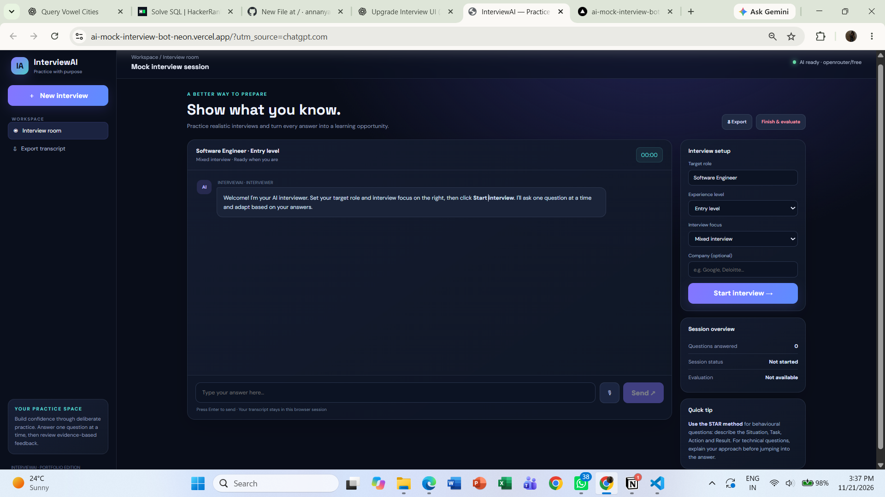

# ✦ AI Mock Interview Bot

<p align="center">
  <b>Your personal AI-powered interview practice space.</b>
  <br/>
  Practice. Improve. Perform with confidence.
</p>

<p align="center">
  <a href="https://ai-mock-interview-bot-neon.vercel.app/">
    
  </a>
</p>

<p align="center">
  
  
  
  
  
</p>

---

## ◈ Overview

**InterviewAI** is an AI-powered mock interview platform designed to help candidates practice technical interviews in an interactive environment.

It uses Large Language Models (LLMs) to generate interview questions, understand candidate responses, and provide structured feedback through an AI-generated performance report.

Whether you're preparing for your first technical interview or improving your communication skills, InterviewAI offers a convenient space to practice and learn.

## ✧ Features

| Feature | Description |
|---|---|
| 🎯 Role-based Interviews | Choose your target job role |
| 🤖 AI Interviewer | Dynamic interview questions powered by an LLM |
| 🎙️ Voice Input | Answer using browser-supported speech recognition |
| ⏱️ Interview Timer | Track your interview duration |
| 📊 AI Evaluation | Get an overall performance score |
| 📝 Feedback Report | Understand strengths and improvement areas |
| 📥 Transcript Export | Export your interview conversation |

## ◈ Live Demo

**Try InterviewAI here:**

https://ai-mock-interview-bot-neon.vercel.app/

## ◈ Application Preview



## ⚙️ Tech Stack

| Technology | Purpose |
|---|---|
| Python | Backend development |
| Flask | Application backend and API |
| HTML & CSS | User interface and styling |
| JavaScript | Frontend interactions |
| OpenRouter API | LLM integration |
| Browser Speech Recognition | Voice input |
| Vercel | Deployment and hosting |

## ◈ How It Works

```text
       Candidate
           |
           v
    Select Interview Role
           |
           v
      AI Interviewer
           |
           v
     Answer Questions
       (Text / Voice)
           |
           v
     AI-based Evaluation
           |
           v
     Performance Report
           |
           v
     Feedback & Improvement
```

## 🚀 Run Locally

### 1. Clone the repository

```bash
git clone https://github.com/annanyaoberoi/ai-mock-interview-bot.git
cd ai-mock-interview-bot
```

### 2. Install dependencies

```bash
pip install -r requirements.txt
```

### 3. Configure environment variables

Create a `.env` file using `.env.example` as a template.

Add your OpenRouter API key:

```env
OPENROUTER_API_KEY=your_api_key_here
OPENROUTER_MODEL=openrouter/free
```

### 4. Start the application

```bash
python app.py
```

### 5. Open in your browser

```text
http://127.0.0.1:5000
```

## ◈ Project Structure

```text
ai-mock-interview-bot/
│
├── app.py
├── index.html
├── requirements.txt
├── .env.example
├── .gitignore
└── README.md
```

## 🔐 Security

- API credentials are stored in environment variables.
- The actual `.env` file is excluded from Git.
- API keys are configured privately through Vercel environment variables.

## ✦ Future Enhancements

- Skill-wise performance analytics
- Interview history and progress tracking
- Enhanced speech-to-text and text-to-speech capabilities
- More personalized interview questions
- Additional interview categories and difficulty levels

---

<p align="center">
  <b>Built with curiosity and a little bit of code. ✦</b>
  <br/>
  Practice smarter. Keep improving.
</p>
